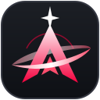

<h1 align="center">Ascend · AION 2 CP Tracker</h1>

Free Windows app that compares your character with the top players of your class and tells you what to upgrade first. 
App gratuita para Windows que compara tu personaje con el top de tu clase y te dice qué mejorar primero.

  

---

## English

### How to install
1. Click the red **Download** button above (or go to [Releases](https://github.com/albertodoradofernandez-sys/ascend-datos/releases/latest)).
2. Under **Assets**, click **`Ascend_x.x.x_x64-setup.exe`** to download it.
   *Don't download "Source code": that's not the app.*
3. Open the file. Windows may show **"Windows protected your PC"** (it's a small app without a paid certificate): click **More info → Run anyway**.
4. Install and open **Ascend** from the Start menu. Type your character name, pick your region and you're ready.

The app **updates itself**: when there's a new version it asks you, and the top-player data downloads on its own every week.

### What it does
- **Gear upgrades:** piece by piece against the top players of your class (Europe by default, Korea BiS optional): soul bind with letter grades, what to reroll and what to look for, manastones, Philosopher's Stone.
- **Damage or CP:** rank every upgrade by the damage it adds against a boss (using your stat sheet) or by CP.
- **Daevanion planner:** your boards with the in-game frames, plus an «Auto» button that builds the best board for your points.
- **Head to head:** compare yourself with anyone, slot by slot.
- Rotation and macro, collections, ranking, patch notes. English and Spanish.
- Also in your browser: https://ascend.albertodoradofernandez.workers.dev

### Is it safe?
- It only uses **NCSOFT's official public character API** (the same data as the official website).
- It does **not** read the game's memory or network traffic and doesn't touch the game client: no ban risk.
- No account, no ads, no data collected.

---

## Español

### Cómo instalarla
1. Pulsa el botón rojo **Download / Descargar** de arriba (o entra en [Releases](https://github.com/albertodoradofernandez-sys/ascend-datos/releases/latest)).
2. En **Assets**, pulsa **`Ascend_x.x.x_x64-setup.exe`** para descargarlo.
   *No bajes «Source code»: eso no es la app.*
3. Ábrelo. Puede salir **«Windows protegió su PC»** (es una app pequeña sin certificado de pago): pulsa **Más información → Ejecutar de todas formas**.
4. Instálala y abre **Ascend** desde el menú Inicio. Escribe el nombre de tu personaje, elige la región y listo.

La app **se actualiza sola**: cuando hay versión nueva te avisa, y los datos del top se descargan solos cada semana.

### Qué hace
- **Mejorar equipo:** pieza a pieza frente al top de tu clase (Europa por defecto, BiS de Corea opcional): soul bind con nota por letra, qué cambiar y qué buscar, manastones y piedra filosofal.
- **Daño o CP:** ordena cada mejora por el daño que te da contra un jefe (con tu hoja de stats) o por el CP.
- **Planificador de Daevanion:** tus tableros con los marcos del juego y un botón «Auto» que monta el mejor tablero para tus puntos.
- **Cara a cara:** compárate con quien quieras, pieza a pieza.
- Rotación y macro, colecciones, ranking y parches. En español e inglés.
- También en el navegador: https://ascend.albertodoradofernandez.workers.dev

### ¿Es segura?
- Solo usa la **API pública oficial de NCSOFT** (los mismos datos que la web oficial).
- **No** lee la memoria ni el tráfico del juego ni toca el cliente: sin riesgo de ban.
- Sin cuenta, sin anuncios y sin recoger datos.

---

This repository also hosts the shared data the app downloads (top players, metas, catalogs). Not affiliated with NCSOFT. ·
Este repositorio también guarda los datos que descarga la app. No está afiliada a NCSOFT.

© 2026 Alberto Dorado Fernández. All rights reserved: free for personal use; copying, modifying, reverse engineering or redistributing the app or its data is not allowed (see [LICENSE](LICENSE)). · Todos los derechos reservados: uso personal gratuito; no se permite copiar, modificar, descompilar ni redistribuir la app ni sus datos.
